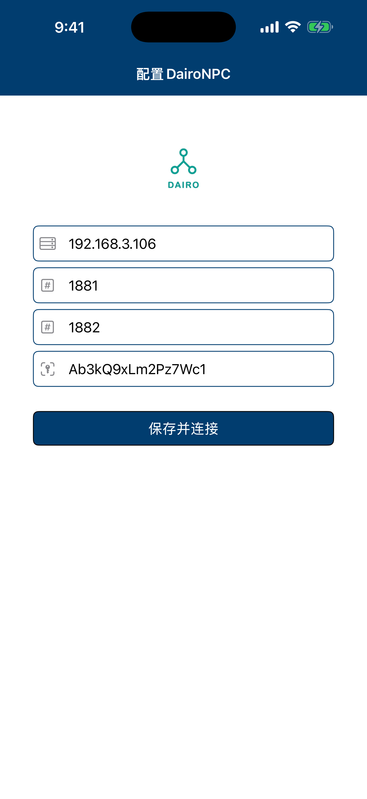
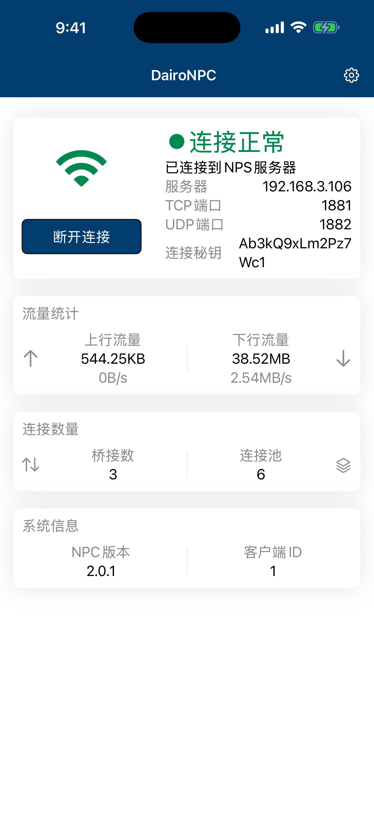
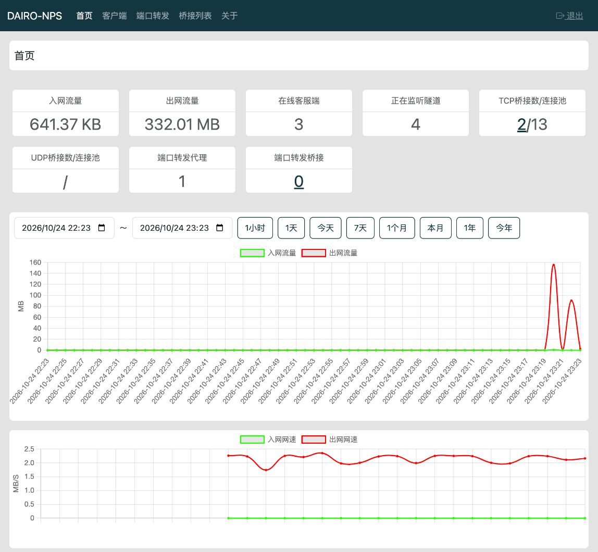
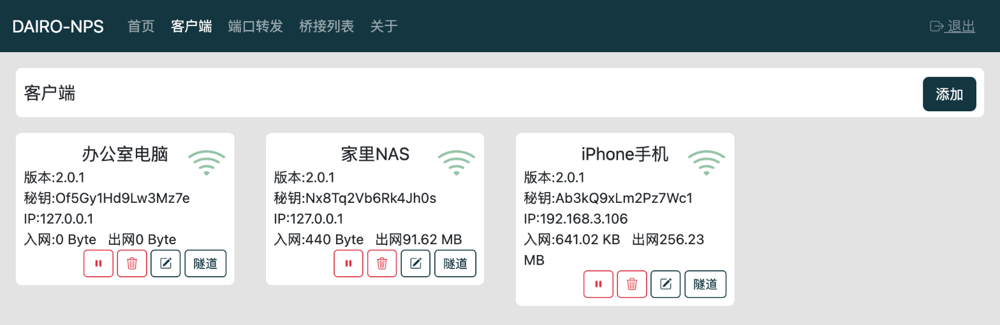
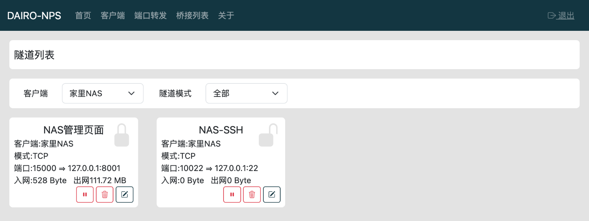
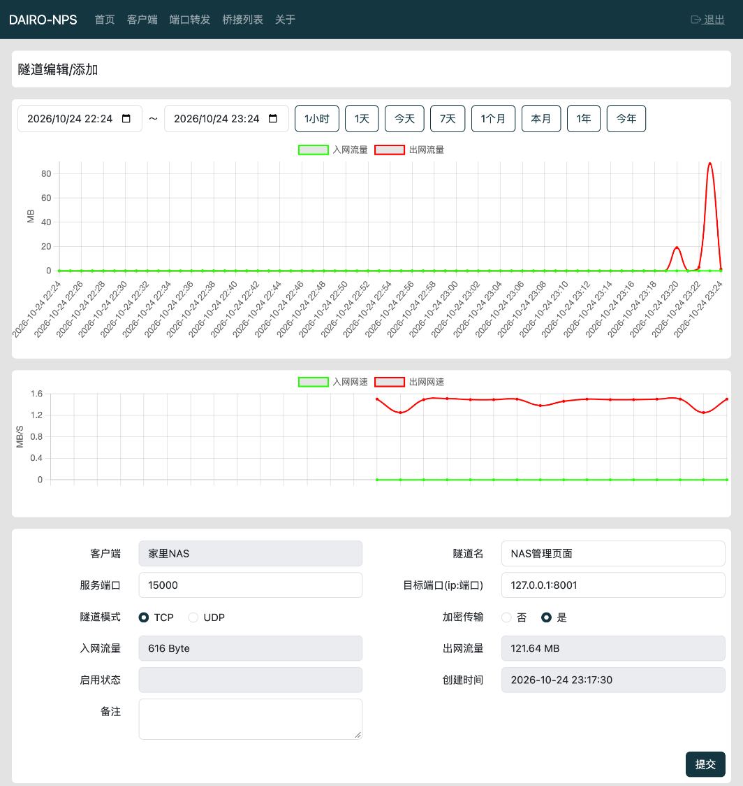
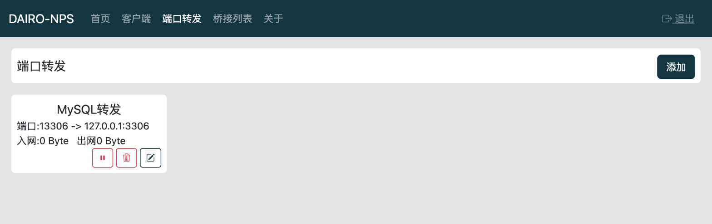
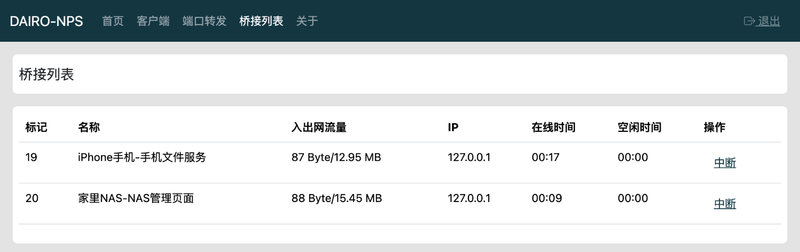

# DairoNPS

DairoNPS 是一个用 Rust 编写的轻量级**内网穿透**工具：把内网（家里、公司、手机所在的局域网）里的服务，通过一台有公网 IP 的服务器映射出去，让你在任何地方都能访问。

- **DairoNPS（服务端）**：部署在公网服务器上，提供 Web 管理后台，负责接收外部访问并转发给客户端。
- **DairoNPC（客户端）**：运行在内网设备上，主动连接服务端，把流量转发到内网服务。提供 Linux / macOS / Windows 命令行版本、Docker 镜像，以及 **iOS / Android App**。

## 功能特性

- **TCP 隧道**：把服务端的某个端口映射到客户端所在内网的任意 `ip:端口`（SSH、远程桌面、NAS、Web 服务、数据库……）。
- **加密传输**：每条隧道可单独开启加密。
- **端口转发**：服务端本机的端口转发（不经过客户端），例如把 `13306` 转发到 `127.0.0.1:3306`。
- **Web 管理后台**：管理客户端、隧道、端口转发，查看在线状态、桥接连接，可主动中断连接。
- **流量统计**：按客户端、隧道统计入网/出网流量，提供历史流量图表和实时网速曲线。
- **连接池**：服务端与客户端之间预先建立连接池，减少建立新连接时的延迟。
- **移动端客户端**：iOS / Android App，在手机上也能把手机所在局域网的服务映射出去。
- **单文件部署**：服务端和客户端都是单个可执行文件，数据保存在本地 SQLite 中，无需额外依赖。

> UDP 隧道功能正在开发中，暂不支持创建 UDP 隧道。

## 工作原理

```
  外部用户                 公网服务器                         内网
┌─────────┐   访问    ┌──────────────────┐   连接池/桥接   ┌───────────┐       ┌──────────┐
│ 浏览器等 │ ───────▶ │ DairoNPS          │ ◀════════════▶ │ DairoNPC  │ ────▶ │ 内网服务  │
└─────────┘  服务端口  │ :1880 Web管理后台  │   :1881 (TCP)   │ (客户端)   │       │ ip:端口   │
                      │ :1881 客户端连接    │                └───────────┘       └──────────┘
                      └──────────────────┘
```

1. 客户端使用**秘钥**连接服务端的 `1881` 端口，保持一条主连接（心跳）。
2. 服务端为该客户端下每条开启的隧道监听一个**服务端口**。
3. 外部访问服务端口时，服务端从连接池中取出一条连接和客户端**桥接**，客户端再连接到隧道配置的**目标端口**，双向转发数据。

## 默认端口

| 端口   | 说明                       | 服务端参数        |
|--------|----------------------------|-------------------|
| `1880` | Web 管理后台               | `--web-port`      |
| `1881` | 客户端连接端口（TCP）       | `--tcp-port`      |
| `1882` | UDP 端口（预留，功能开发中） | `--udp-port`      |

除此之外，每条隧道/端口转发配置的**服务端口**也需要在服务器防火墙、安全组中放行。

## 快速开始

### 1. 部署服务端

**方式一：直接运行**

从 [Releases](https://github.com/DAIRO-HY/DairoNPS-R/releases) 下载对应平台的 `DairoNPS` 文件：

```bash
chmod +x DairoNPS
./DairoNPS --data-dir ./data
```

**方式二：Docker Compose**

```yaml
services:
  dairo-nps:
    restart: always
    image: dairopapa/dairo-nps:2.0.1
    # 建议使用host模式,性能更好,隧道端口也不用一个个映射
    network_mode: host
    environment:
      DAIRO_NPS_WEB_PORT: 1880
      DAIRO_NPS_TCP_PORT: 1881
      DAIRO_NPS_UDP_PORT: 1882
    volumes:
      # 数据库、账号文件保存在这里,挂载出来防止重建容器后数据丢失
      - ./data:/app/data
```

```bash
docker compose up -d
```

### 2. 登录管理后台

浏览器打开 `http://服务器IP:1880`。

**第一次登录时直接输入用户名和密码，系统会用你输入的内容创建管理员账号**，请务必设置一个足够强的密码。

忘记密码时，删除数据目录下的 `account.txt` 后重新登录即可重新设置。

### 3. 添加客户端

进入「客户端」→「添加」，填写名称和**秘钥**（最长 32 位，每个客户端的秘钥必须唯一）。客户端启动时用这个秘钥连接服务端。

### 4. 添加隧道

在客户端卡片上点「隧道」→「添加」：

| 字段             | 说明                                                       |
|------------------|------------------------------------------------------------|
| 隧道名           | 随便起一个便于识别的名字                                     |
| 服务端口         | 服务端对外监听的端口，外部用户访问 `服务器IP:服务端口`         |
| 目标端口(ip:端口) | 客户端能访问到的内网地址，例如 `127.0.0.1:22`、`192.168.1.10:5000` |
| 隧道模式         | TCP                                                         |
| 加密传输         | 是否加密服务端与客户端之间的数据                              |

### 5. 运行客户端

**命令行**

从 [Releases](https://github.com/DAIRO-HY/DairoNPS-R/releases) 下载对应平台的 `DairoNPC`：

```bash
./DairoNPC --host 服务器IP或域名 --key 客户端秘钥
```

| 参数               | 环境变量              | 默认值       | 说明                     |
|--------------------|-----------------------|--------------|--------------------------|
| `--host`           | `DAIRO_NPC_HOST`      | `127.0.0.1`  | 服务端地址                |
| `-t, --tcp-port`   | `DAIRO_NPC_TCP_PORT`  | `1881`       | 服务端 TCP 端口           |
| `-u, --udp-port`   | `DAIRO_NPC_UDP_PORT`  | `1882`       | 服务端 UDP 端口           |
| `-k, --key`        | `DAIRO_NPC_KEY`       | 无（必填）    | 在管理后台添加客户端时设置的秘钥 |

**Docker Compose**

```yaml
services:
  dairo-npc:
    restart: always
    image: dairopapa/dairo-npc:2.0.1
    network_mode: host
    environment:
      DAIRO_NPC_HOST: www.example.com
      DAIRO_NPC_TCP_PORT: 1881
      DAIRO_NPC_UDP_PORT: 1882
      DAIRO_NPC_KEY: 你的客户端秘钥
```

**iOS / Android App**

打开 App，填写服务器地址、TCP 端口、UDP 端口和连接秘钥，点「保存并连接」即可。首页可以看到连接状态、流量、网速、桥接数和连接池数量。

| 配置                                                         | 运行状态                                                   |
|--------------------------------------------------------------|------------------------------------------------------------|
|  |  |

客户端连上后，管理后台的客户端卡片会显示在线图标，访问 `服务器IP:服务端口` 就能访问到内网服务了。

## 服务端参数

所有参数都可以用命令行或环境变量设置，执行 `./DairoNPS --help` 查看。

| 参数                               | 环境变量                                | 默认值    | 说明                                   |
|------------------------------------|-----------------------------------------|-----------|----------------------------------------|
| `--web-port`                       | `DAIRO_NPS_WEB_PORT`                    | `1880`    | Web 管理后台端口                        |
| `--tcp-port`                       | `DAIRO_NPS_TCP_PORT`                    | `1881`    | 客户端连接端口                          |
| `--udp-port`                       | `DAIRO_NPS_UDP_PORT`                    | `1882`    | UDP 端口                               |
| `--data-dir`                       | `DAIRO_NPS_DATA_DIR`                    | `./data`  | 数据目录（数据库、账号文件）              |
| `--max-pool-count`                 | `DAIRO_NPS_MAX_POOL_COUNT`              | `6`       | 每个客户端最大连接池数                   |
| `--min-pool-count`                 | `DAIRO_NPS_MIN_POOL_COUNT`              | `1`       | 每个客户端最小连接池数                   |
| `--add-pool-count`                 | `DAIRO_NPS_ADD_POOL_COUNT`              | `1`       | 连接池不足时每次补充的数量               |
| `--recycle-pool-time-out`          | `DAIRO_NPS_RECYCLE_POOL_TIME_OUT`       | `180000`  | 空闲连接池回收时间（毫秒）               |
| `--read-cache-size`                | `DAIRO_NPS_READ_CACHE_SIZE`             | `8192`    | 读取数据缓冲区大小（字节）               |
| `--traffic-stats-expired`          | `DAIRO_NPS_TRAFFIC_STATS_EXPIRED`       | `0`       | 流量统计数据保留时间（秒），0 为永久保留    |
| `--data-collect-interval`          | `DAIRO_NPS_DATA_COLLECT_INTERVAL`       | `1000`    | 流量采集间隔（毫秒）                     |
| `--data-collect-insert-interval`   | `DAIRO_NPS_DATA_COLLECT_INSERT_INTERVAL`| `6000`    | 流量统计写入数据库间隔（毫秒）            |

## 从源码编译

需要 Rust（edition 2024）环境。

```bash
# 服务端
cargo build --release --package DairoNPS

# 命令行客户端
cargo build --release --package DairoNPC
```

移动端的 Rust 库：

```bash
# Android:需要 cargo-ndk 和 Android NDK,编译后自动复制到 DairoNPC-Android 的 jniLibs 目录
./document/build/build_lib_npc_android.sh

# iOS:编译 xcframework 到 DairoNPC-IOS 目录
./document/build/build_lib_npc_ios.sh
```

然后分别用 Android Studio 打开 `DairoNPC-Android`、用 Xcode 打开 `DairoNPC-IOS` 编译 App。

## 项目结构

```
DairoNPS/          服务端(含 Web 管理后台)
DairoNPC/          命令行客户端
lib_npc/           客户端核心逻辑(命令行、iOS、Android 共用)
lib_npc_ios/       iOS 的 C 接口封装
lib_npc_android/   Android 的 JNI 接口封装
lib_np_common/     服务端与客户端共用代码
lib_db/            数据库初始化与迁移
DairoNPC-IOS/      iOS App(SwiftUI)
DairoNPC-Android/  Android App(Jetpack Compose)
document/          构建脚本、Dockerfile、文档与截图
```

## 安全提示

- 管理后台第一次登录即创建账号，**部署后请立即登录**设置管理员账号，防止被他人抢先设置。
- 客户端秘钥相当于客户端的密码，请使用足够长的随机字符串，不要泄露。
- 只开放需要的端口；不需要对外开放的隧道请及时停用或删除。

## 管理后台截图

**首页**：总流量、在线客户端数、隧道数、连接池情况，以及流量和实时网速图表。



**客户端**：查看客户端在线状态、版本、IP 和流量，可停用、编辑、删除。



**隧道列表**：按客户端和隧道模式筛选，锁图标表示是否开启加密传输。



**隧道详情**：单条隧道的流量统计、实时网速和配置。



**端口转发**



**桥接列表**：当前正在通信的连接，可以手动中断。


